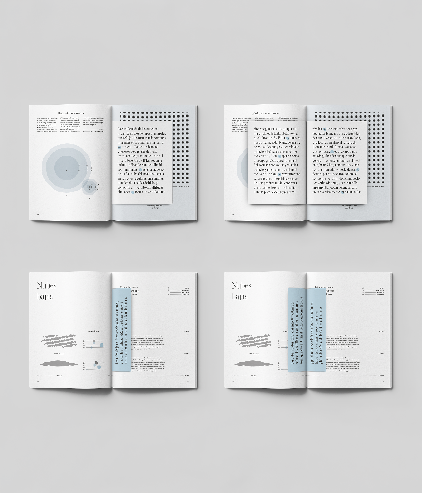
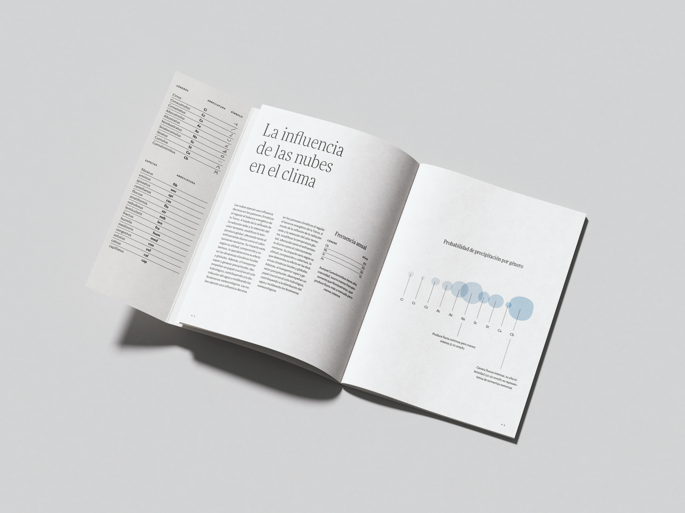
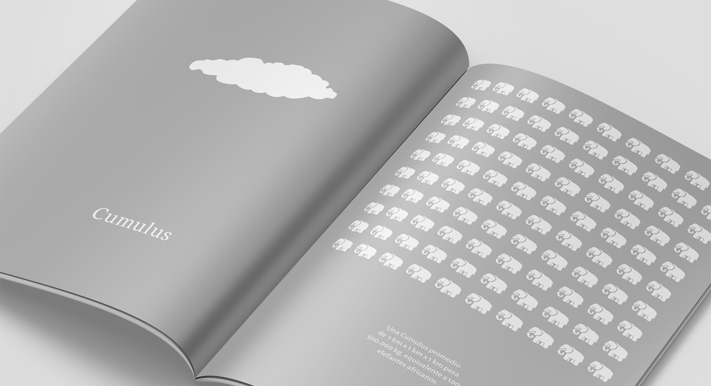
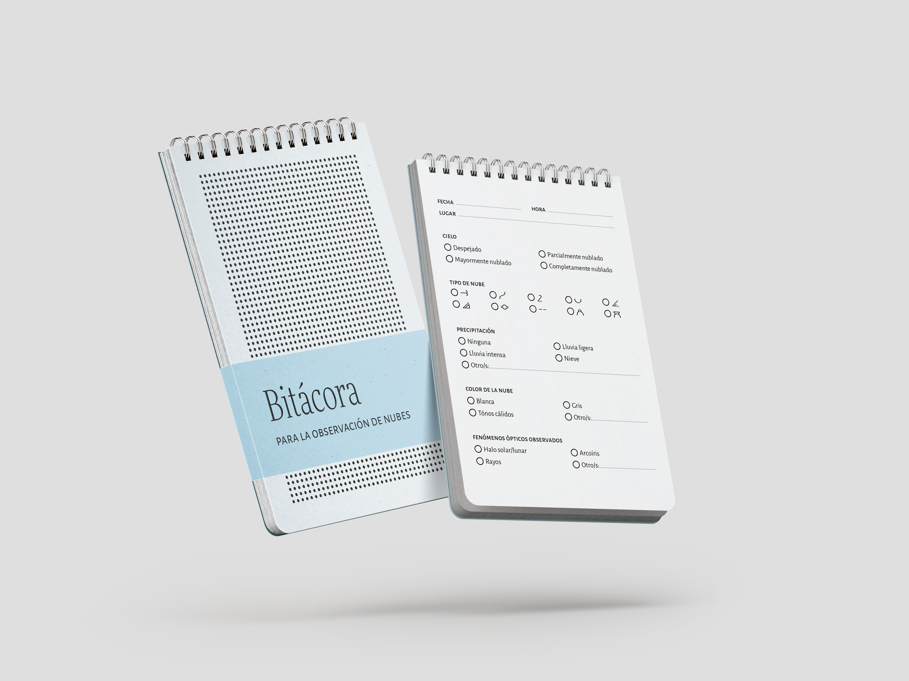
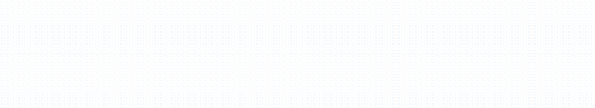

import { Image } from 'astro:assets'
import nubes01 from '../../assets/proyectos/nubes/behance-nubes-01.jpg'
import nubes02 from '../../assets/proyectos/nubes/behance-nubes-02.png'
import nubes04 from '../../assets/proyectos/nubes/behance-nubes-04.png'
import nubes05 from '../../assets/proyectos/nubes/behance-nubes-05.gif'
import nubes10 from '../../assets/proyectos/nubes/behance-nubes-10.png'
import nubes11 from '../../assets/proyectos/nubes/behance-nubes-11.png'

    <Image src={nubes01} widths={[800, 1600]} sizes="(max-width: 768px) 100vw, 50vw" alt="Mockup de la tapa de la revista Las nubes, con círculos celestes superpuestos" />
    <Image src={nubes02} widths={[800, 1600]} sizes="(max-width: 768px) 100vw, 50vw" alt="Manos sosteniendo una notebook contra el cielo, con la herramienta interactiva abierta" />

    <Image src={nubes04} class="img-h-30" widths={[800, 1600]} sizes="(max-width: 768px) 100vw, 70vw" alt="Doble página de la revista sobre albedo y efecto invernadero" />
    <Image src={nubes05} class="img-v-15" widths={[800, 1600]} sizes="(max-width: 768px) 100vw, 35vw" alt="Animación que compara Cirrocumulus y Cirrostratus con tramas de puntos" />

 

 
 
 
 

    <Image src={nubes10} class="img-v-15" widths={[800, 1600]} sizes="(max-width: 768px) 100vw, 35vw" alt="Mano sosteniendo un celular con la ficha del Altocumulus" />
    <Image src={nubes11} class="img-h-30" widths={[800, 1600]} sizes="(max-width: 768px) 100vw, 70vw" alt="Doble página de la revista sobre nubes altas, con ilustraciones de Cirrus" />

 

 
 
 