import { Image } from 'astro:assets'
import vinilos03 from '../../assets/proyectos/vinilos/vinilos-pag-3.gif'
import vinilos04 from '../../assets/proyectos/vinilos/vinilos-pag-4.png'
import vinilos09 from '../../assets/proyectos/vinilos/vinilos-pag-9.png'
import vinilos10 from '../../assets/proyectos/vinilos/vinilos-pag-10.gif'

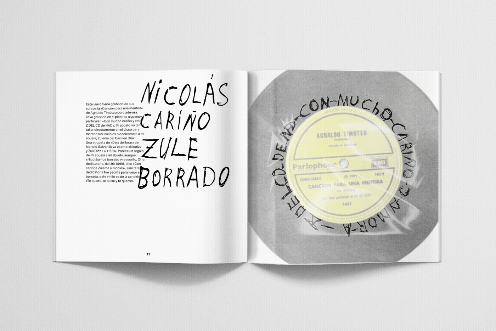
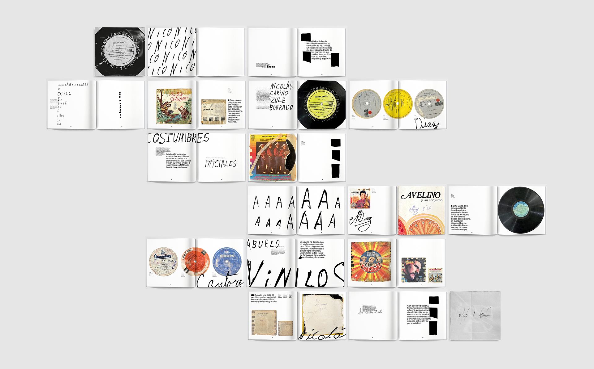

    <Image src={vinilos03} class="img-v" widths={[800, 1600]} sizes="(max-width: 768px) 100vw, 25vw" alt="Animación de etiquetas de vinilos junto a la firma manuscrita 'Nicolás'" />
    <Image src={vinilos04} class="img-h" widths={[800, 1600]} sizes="(max-width: 768px) 100vw, 80vw" alt="Doble página con un vinilo de José Larralde firmado en la etiqueta" />

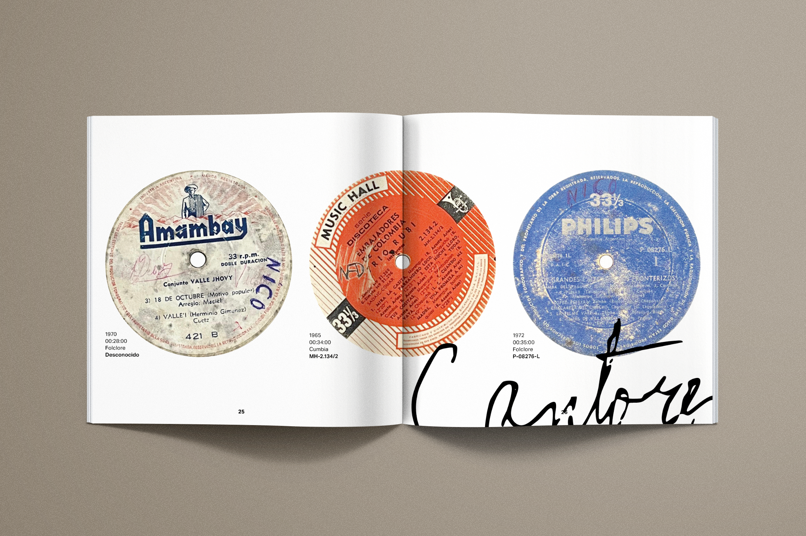
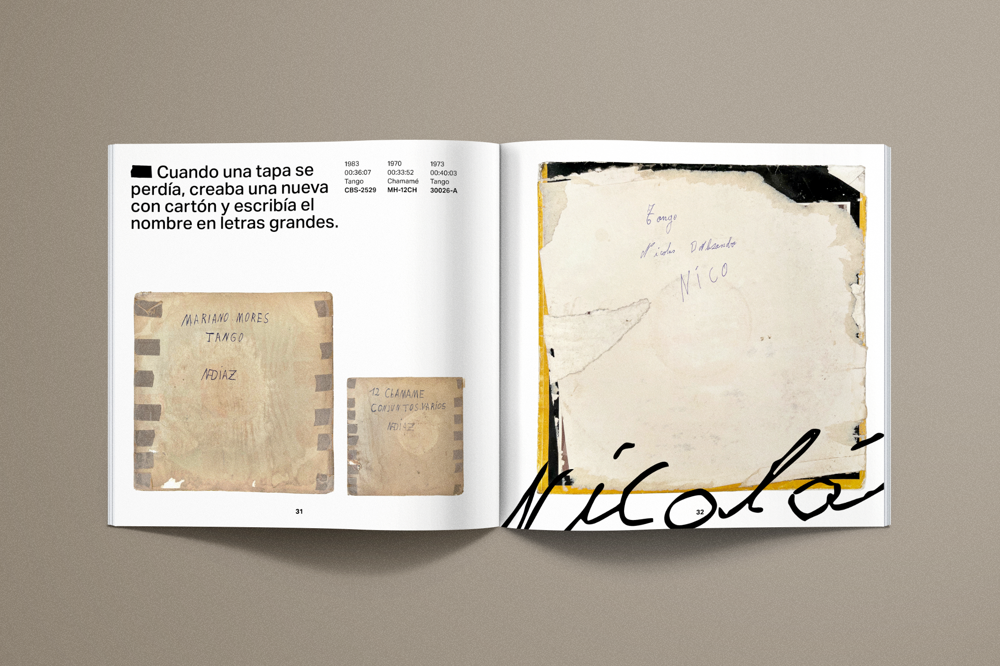
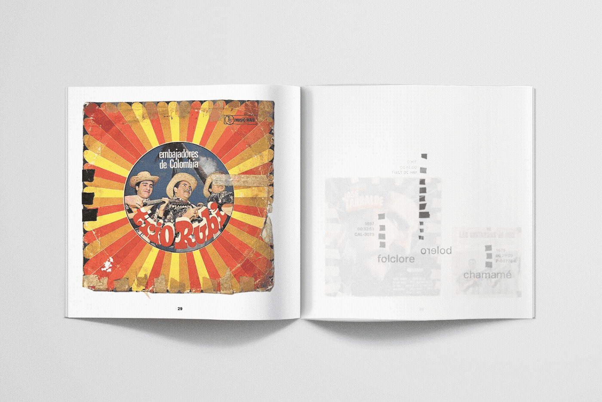
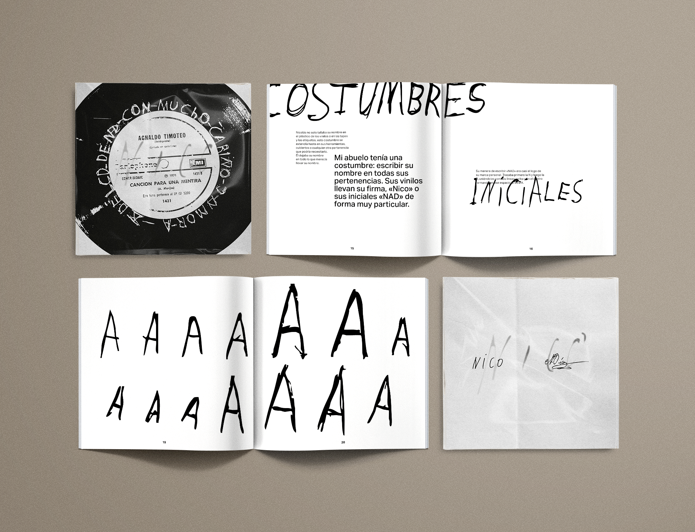

  <Image src={vinilos09} class="img-h" widths={[800, 1600]} sizes="(max-width: 768px) 100vw, 80vw" alt="Doble página de apertura con la dedicatoria al abuelo" />
  <Image src={vinilos10} class="img-v" widths={[800, 1600]} sizes="(max-width: 768px) 100vw, 25vw" alt="Animación de una tapa de vinilo rota y emparchada, con 'Tango' escrito a mano" />

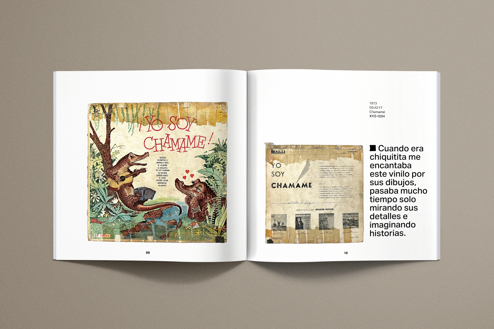
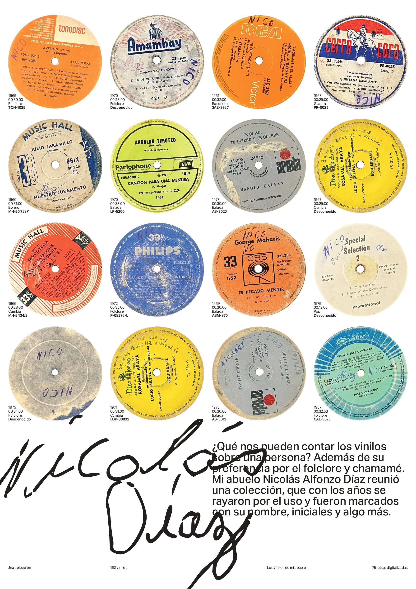
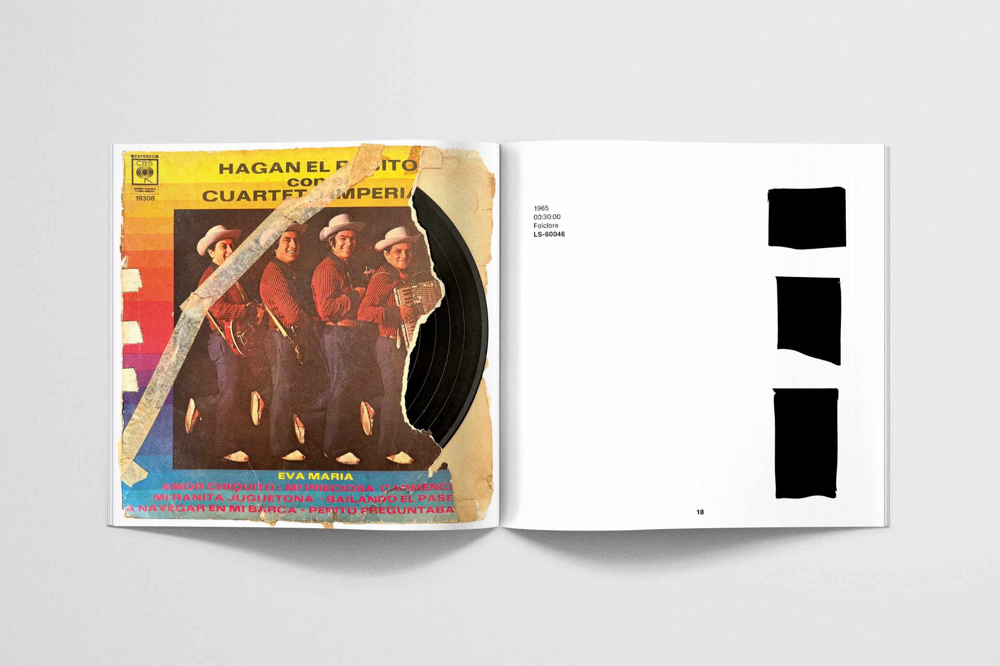
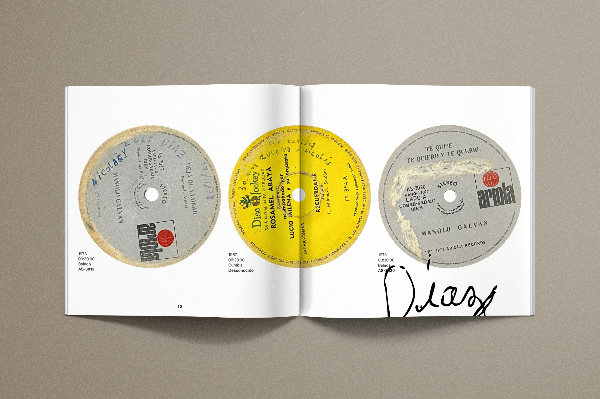
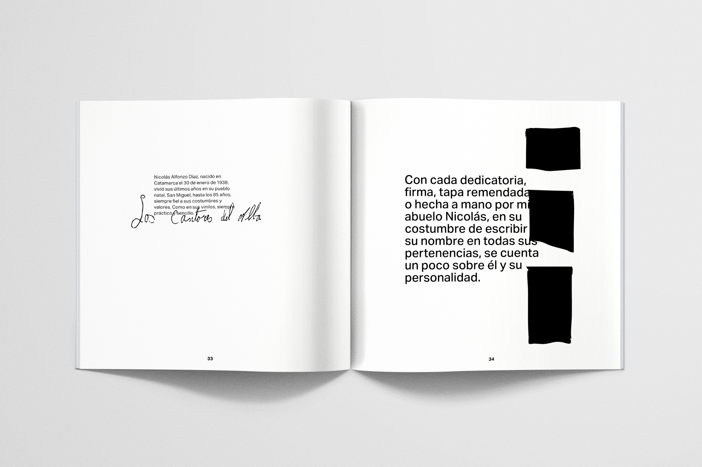